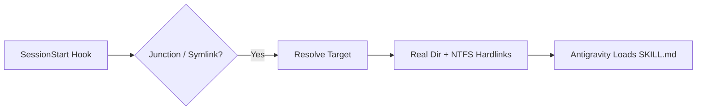

# antigravity-junction-skill-fix

[](LICENSE)
[](https://www.microsoft.com/windows)
[](https://antigravity.google)
[](https://github.com/wllzhang/awesome-antigravity-tools)
[](https://github.com/PowerShell/PowerShell)

**antigravity-junction-skill-fix** is an open-source Antigravity plugin and standalone utility that solves the issue where Antigravity cannot discover skills mounted via Windows directory links (NTFS Junctions `mklink /J` or Directory Symlinks `mklink /D`).

[中文说明 (Chinese Documentation)](README.zh-CN.md)

---

## 🔍 The Problem

Antigravity's core engine uses a Go-based Language Server (`language_server_windows_x64.exe`). On Windows NTFS file systems:
- Directory Junctions and Symlinks carry the `FILE_ATTRIBUTE_REPARSE_POINT` attribute.
- Go's standard library `os.ReadDir` returns `DirEntry` whose `entry.IsDir()` evaluates to **`false`** for reparse points.
- Go's official `filepath.Walk` and `filepath.WalkDir` behavior explicitly specifies: **"Walk does not follow symbolic links"**.
- As a result, any Skill mounted as a directory link (such as `ego-browser` or package-manager-linked skills) is completely ignored during skill discovery.

---

## 💡 The Solution: Zero-Copy Hardlink Directory Bridge

This project automatically detects directory junctions and symlinks across your global (`~/.gemini/config/skills/`) and workspace skill folders, transforming them into **real directories (`d----`)** containing **NTFS Hardlinks**:



### Key Advantages:
1. **Zero Additional Disk Usage**: On the same NTFS drive (e.g. `C:` to `C:`), files are created as hardlinks pointing directly to the target's MFT record.
2. **Instant Live Synchronization**: Editing files in the source application is immediately reflected in Antigravity without needing a re-sync.
3. **100% Reversible**: Each bridge folder stores `.bridge_meta.json`. Running `-Action Restore` reverts real directories back into original junctions cleanly without touching source files.
4. **Cross-Platform Resilient**: If checked into a repository shared with macOS/Linux, it gracefully no-ops without throwing errors.
5. **Zero Hardcoded Paths**: Strictly environment-agnostic; resolves all directories dynamically.

---

## 🚀 Quick Start

### Option 1: Install as Antigravity Plugin (Recommended)

Clone the repository and run the installer:

```powershell
git clone https://github.com/wllzhang/antigravity-junction-skill-fix.git
cd antigravity-junction-skill-fix
pwsh -ExecutionPolicy Bypass -File .\install.ps1
```
*(Or in Windows PowerShell 5.1: `powershell -ExecutionPolicy Bypass -File .\install.ps1`)*

The installer copies the plugin into `~/.gemini/config/plugins/antigravity-junction-skill-fix` and triggers an initial bridge scan. From then on, every new conversation session in Antigravity automatically checks and keeps your skills bridged!

---

### Option 2: Standalone CLI Usage

You can also use `scripts/bridge.ps1` as a standalone utility without installing the plugin:

```powershell
# 1. Scan for raw directory junctions and bridged skills
pwsh .\scripts\bridge.ps1 -Action Scan

# 2. Bridge all junctions in global & workspace directories
pwsh .\scripts\bridge.ps1 -Action Bridge

# 3. Incrementally sync newly added files from source
pwsh .\scripts\bridge.ps1 -Action Sync

# 4. Revert all bridges back to original NTFS Junctions
pwsh .\scripts\bridge.ps1 -Action Restore

# 5. Inspect status
pwsh .\scripts\bridge.ps1 -Action Status
```

You can target a specific directory using `-TargetDir`:
```powershell
pwsh .\scripts\bridge.ps1 -Action Bridge -TargetDir "D:\my-skills"
```

---

## 🛠️ Uninstallation

To cleanly restore all skills to their original Junction state and remove the plugin:

```powershell
pwsh .\scripts\uninstall.ps1
```

---

## 🧪 Testing

The project includes an end-to-end test suite testing detection, 2-tier junction chains, hardlink synchronization, incremental sync, and restore:

```powershell
pwsh -ExecutionPolicy Bypass -File .\tests\bridge.Tests.ps1
```

All tests run automatically on GitHub Actions (`windows-latest`) on every PR and commit.

---

## 📄 License

[MIT License](LICENSE) © 2026 Antigravity Community
