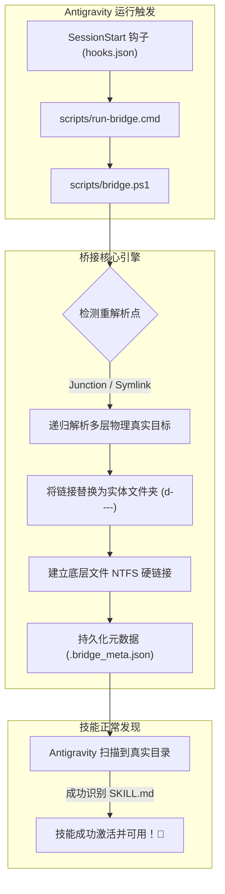

# antigravity-junction-skill-fix (Antigravity Windows 目录链接修复插件与工具集)

[](LICENSE)
[](https://www.microsoft.com/windows)
[](https://antigravity.google)
[](https://github.com/PowerShell/PowerShell)

**antigravity-junction-skill-fix** 是一套开源的 Antigravity 插件与独立命令行工具，专为解决 Antigravity 在 Windows 下**无法识别通过目录联接（NTFS Junction `mklink /J`）或目录符号链接（Symlink `mklink /D`）挂载的 Skills** 这一硬伤问题而设计。

[English Documentation (英文文档)](README.md)

---

## 🔍 问题根因解析

Antigravity 的核心文件发现与调度引擎是基于 Go 语言编译的本地 Language Server（`language_server_windows_x64.exe`）。

在 Windows NTFS 文件系统下：
1. 任何通过 `mklink /J` 或 `mklink /D` 创建的目录链接均带有 Windows `FILE_ATTRIBUTE_REPARSE_POINT`（重解析点）属性，在 PowerShell 中标记为 `l----`。
2. Go 标准库在 Windows 上的 `os.ReadDir` 返回的 `DirEntry`，其 `entry.IsDir()` 会判定为 **`false`**。
3. Go 官方的 `filepath.Walk` 与 `filepath.WalkDir` 规范明确写道：“**Walk does not follow symbolic links**”（目录遍历不追踪符号链接）。
4. 这导致通过目录链接挂载的技能（例如 `ego-browser`、包管理器外部引用的技能等）被 Antigravity 的技能扫描引擎**直接完全忽略**，无法在可用技能列表中展示或激活。

---

## 💡 解决方案：零磁盘开销实体硬链接桥接 (Hardlink Directory Bridge)

本工具通过检测技能目录（全局 `~/.gemini/config/skills/` 以及工作区目录），将所有目录链接透明重构为**实体文件夹（`d----`）**，内部文件直接使用 **NTFS 文件硬链接（Hardlink）** 映射回原始物理目录：



### 核心技术优势：
1. **零空间冗余（Zero Copy）**：同一逻辑卷（如 C: 到 C:）内硬链接指向同一底层 MFT 数据，不占用任何额外磁盘空间。
2. **实时双向同步**：硬链接文件修改即时两端生效，源程序更新技能内容时，Antigravity 侧瞬间可见，无需重复复制。
3. **100% 安全可逆**：每个桥接目录自动写入隐藏的 `.bridge_meta.json` 记录原始链接信息。运行 `-Restore` 可将目录无损还原回原始 Junction，卸载无残留。
4. **跨卷自动降级**：若源目录跨越磁盘（如 D: 到 C:），自动降级为文件镜像模式。
5. **杜绝隐私泄露**：全代码零硬编码个人路径，动态适配任意 Windows 环境。

---

## 🚀 快速上手

### 方式 1：作为 Antigravity 插件一键安装（推荐）

克隆仓库并执行安装脚本：

```powershell
git clone https://github.com/wllzhang/antigravity-junction-skill-fix.git
cd antigravity-junction-skill-fix
pwsh -ExecutionPolicy Bypass -File .\install.ps1
```
*(如果是 Windows PowerShell 5.1 环境，可运行 `powershell -ExecutionPolicy Bypass -File .\install.ps1`)*

安装程序会将插件部署到 `~/.gemini/config/plugins/antigravity-junction-skill-fix` 并立即执行一次全量扫描桥接。从此以后，Antigravity 每次创建新会话（`SessionStart`）都会自动维护所有技能链接，彻底实现静默无感运行！

---

### 方式 2：纯命令行独立运行（无需安装插件）

您也可以将 `scripts/bridge.ps1` 作为独立的 CLI 脚本调用：

```powershell
# 1. 扫描当前有哪些未识别的目录链接与已桥接目录
pwsh .\scripts\bridge.ps1 -Action Scan

# 2. 执行桥接转换 (将 Junction 转为硬链接目录)
pwsh .\scripts\bridge.ps1 -Action Bridge

# 3. 增量同步 (当源目录新增文件时同步硬链接)
pwsh .\scripts\bridge.ps1 -Action Sync

# 4. 一键无损还原 (撤销桥接，恢复为原始 Junction)
pwsh .\scripts\bridge.ps1 -Action Restore

# 5. 查看当前状态清单
pwsh .\scripts\bridge.ps1 -Action Status
```

指定自定义扫描路径：
```powershell
pwsh .\scripts\bridge.ps1 -Action Bridge -TargetDir "D:\my-skills"
```

---

## 🛠️ 彻底卸载

如需卸载，运行卸载脚本即可将所有已桥接技能安全恢复为原始 Junction 状态，并清理插件自身文件：

```powershell
pwsh .\scripts\uninstall.ps1
```

---

## 🧪 自动化测试

项目内置端到端全生命周期测试套件，全面覆盖多层嵌套链接解析、实体目录转换、硬链接实时同步、增量文件添加与逆向还原：

```powershell
pwsh -ExecutionPolicy Bypass -File .\tests\bridge.Tests.ps1
```

测试在 GitHub Actions（`windows-latest` 虚拟机）上对 `pwsh` 与 `powershell` 进行持续集成验证。

---

## 📄 开源许可证

本项目基于 [MIT License](LICENSE) 开源发布。
